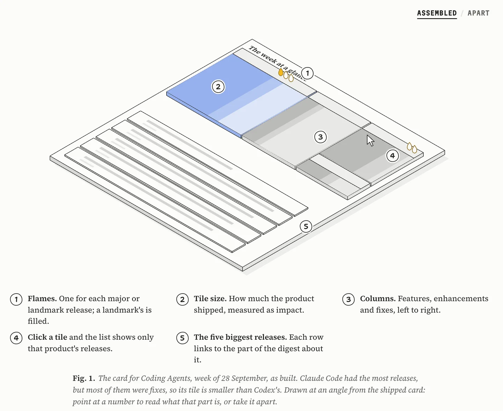
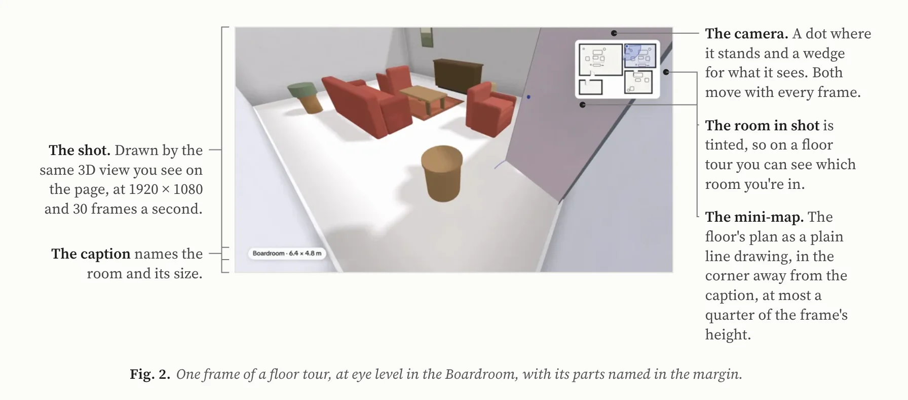
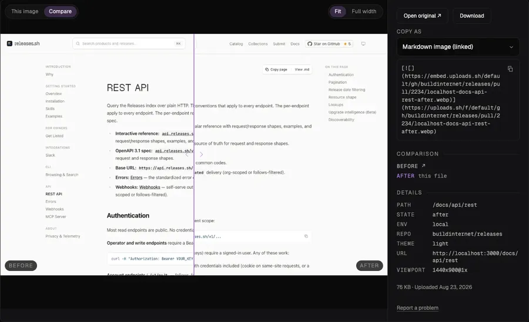
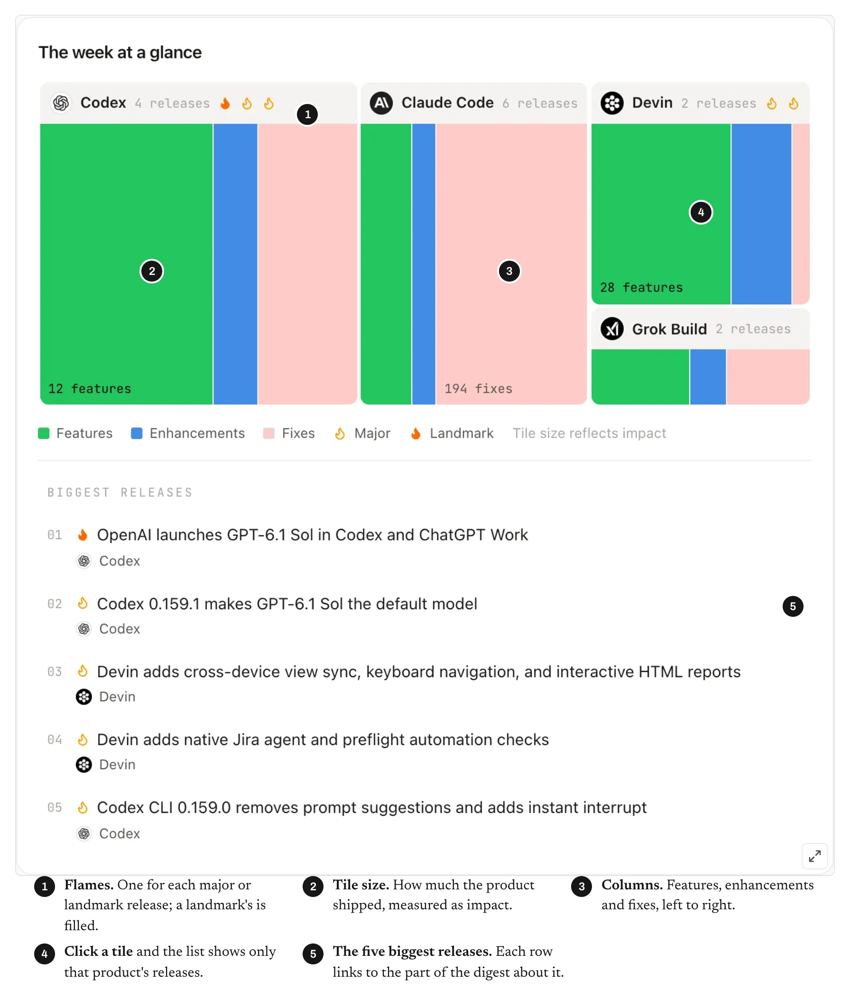
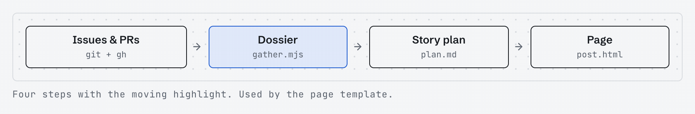

<h1 align="center">buildnotes</h1>

<p align="center"><b>A Claude Code skill that turns the history of a feature into a post about how it was built and why.</b><br>It reads the issues, PRs, commits, reviews and screenshots, finds the two or three decisions that shaped the feature,<br>and publishes a self-contained page with diagrams, motion, before/after visuals and real code.</p>

<p align="center">
  <a href="https://buildnotes.releases.sh">Website</a> ·
  <a href="#quick-start">Quick start</a> ·
  <a href="#examples">Examples</a> ·
  <a href="#flavors">Flavors</a> ·
  <a href="#motion-cut">Motion cut</a> ·
  <a href="#how-it-works">How it works</a> ·
  <a href="#limits">Limits</a> ·
  <a href="#docs">Docs</a>
</p>

<p align="center">
  
</p>

<p align="center"><sub><code>examples/releases-weekly-digests</code>: Fig. 1 of a build story the skill wrote from a public repo's PRs. Its parts are measured from the shipped card, and on the page they lift, come apart and explain themselves.</sub></p>

---

Point Claude at an issue, a few PRs, a search phrase or a commit range, and ask it to write up how the feature was built. buildnotes gathers the record into a dossier, zooms out to the product as users meet it, picks an angle, and plans one chapter per idea, not per day. Then it draws the visuals from small specs, writes the page, and checks it: a linter for length, phrasing, process detail and safety, a link check, and a render pass at desktop and phone width in light and dark.

The skill exists to prevent three kinds of post:

- **The play-by-play.** The development process narrated in order, with timestamps, PR numbers and who reviewed what.
- **The changelog in prose.** Every change listed, no argument.
- **The press release.** Confident claims with nothing behind them.

The cure is the same for all three: find the few ideas and decisions that made the feature what it is, explain each at the level the reader needs, and back each one with real evidence from the record.

## Quick start

```bash
npx skills add buildinternet/buildnotes -g -a claude-code
```

For OpenCode or Codex, swap the agent: `-a opencode` or `-a codex`. Cloning with git works too; see [Install](docs/install.md).

Then, inside the repo the feature lives in, ask in plain words. The skill triggers on any request to write up how a feature was built, even one that never says "blog":

```text
/buildnotes write up how we built the weekly digests (#412)
/buildnotes how we built preview links, from PRs 120, 131 and 140
/buildnotes a release story for the rate-limit work (search "rate limit", the CLI half is in acme/cli)
/buildnotes a technical deep dive on the sync engine since v1.2.0, with the build log module
/buildnotes video tech explainer of our latest PR
```

Open with `post` or `video` to name the output; with neither, the skill writes the post and works out the rest from your words. `video` writes the post first, then cuts the [motion cut](#motion-cut) from it.

OpenCode takes the same `/buildnotes` command; in Codex, type `$buildnotes`.

You get back a link to a private Artifact page, plus at most three open questions and two notes, one line each. The plan, notes, dossier and `post.html` stay in the work dir. Ask for `--standalone` HTML for your own site, or for the chapters as Markdown or MDX.

You need Node 22 or later, `git`, and Chrome for the render pass and figure export. The scripts use only Node's built-in modules, so there is nothing to `npm install`. An authenticated [`gh`](https://cli.github.com) gives the fullest record of issues, PRs and reviews; without it, the skill reads them through a GitHub MCP server, or from public GitHub pages for a public repo ([details](docs/install.md#without-the-github-cli)).

## Examples

Three full runs are kept as committed examples. Each folder holds the finished page (one self-contained file with every image embedded), the story plan the agent wrote before drafting, its notes, the specs behind the rendered figures, and a [motion cut](#motion-cut) with its video. All three are also on the [website](https://buildnotes.releases.sh/examples/).

<table>
  <tr>
    <td width="50%"></td>
    <td width="50%"></td>
  </tr>
  <tr>
    <td><sub><b><a href="examples/sunny-walkthrough-videos">Walkthrough videos</a></b>: a build story about room, floor and project tours in <a href="https://app.sunnysdk.com">Sunny</a>, a furniture and space planner. The repo is private, so the post quotes no code and links nothing internal. Field notes style. <a href="https://buildnotes.releases.sh/examples/sunny-walkthrough-videos/">Read it on the site</a>, or watch its <a href="examples/sunny-walkthrough-videos/motion.mp4">52-second cut</a>.</sub></td>
    <td><sub><b><a href="examples/uploads-before-after">Before and after</a></b>: a build story about before/after comparison on <a href="https://uploads.sh">uploads.sh</a>, from the public <code>buildinternet/uploads</code> repo. Its figures are the product in use, captured live. Plain style. <a href="https://buildnotes.releases.sh/examples/uploads-before-after/">Read it on the site</a>, or watch its <a href="examples/uploads-before-after/motion.mp4">47-second cut</a>.</sub></td>
  </tr>
  <tr>
    <td colspan="2"></td>
  </tr>
  <tr>
    <td colspan="2"><sub><b><a href="examples/releases-weekly-digests">Weekly digests</a></b>: a build story about the weekly collection digests on Release Notes Index, from the public <code>buildinternet/releases</code> repo. <a href="https://buildnotes.releases.sh/examples/releases-weekly-digests/">Read it on the site</a> in field notes, with the card above as its first figure, or open <a href="examples/releases-weekly-digests/post.html"><code>post.html</code></a> for the same post in the Plain style. Its <a href="examples/releases-weekly-digests/motion.mp4">one-minute cut</a> plays in the <a href="#motion-cut">Motion cut</a> section below.</sub></td>
  </tr>
</table>

## Flavors

Three flavors. The skill picks one from the request and the size of the change, and you can ask for another.

| | **Release story** | **Build story** (default) | **Technical deep dive** |
|---|---|---|---|
| Reader | Users and prospective users | Developers who know the product | Engineers who want the mechanism |
| Answers | What's new, why it matters, how to use it | What we built, how it works, what shaped it | How it works inside, the trade-offs, the edge cases |
| Visuals | Screenshots, before/after, one simple flow | Diagrams, motion, before/after | Diagrams, terminal runs, charts |
| Code | A usage example at most | Only where the code is the idea | Where it helps |
| Length | Up to 1,200 words | Up to 2,500 words | As long as it needs |

Word counts are ceilings, not targets. A small change gets a **note** of a paragraph or three. A typo fix or a dependency bump gets an honest "not worth a post", and if it is one piece of a bigger idea, the skill names that idea and asks whether to write about it instead.

## Visuals

Every visual is drawn by [`viz.mjs`](skills/buildnotes/scripts/viz.mjs) from a small spec: JSON for most kinds, Markdown tables for options and matrices, GLSL for shaders. The output is plain HTML, SVG and CSS that inherits the page's theme, works in light and dark, reflows at phone width, and respects reduced motion. The kinds are **flow**, **options**, **matrix**, **delta**, **line**, **bars**, **steps**, **strip**, **term**, **code**, **shader** and **anatomy**; each is shown with its spec in [Visual components](docs/components.md).

## Motion cut

Some people won't read a 1,500-word post but will watch a minute of video. The motion cut is the post as a reel of five to nine scenes that plays itself: the title, the problem, one scene for each idea, and how to try it. The agent writes a short scene script (`motion.json`) from the finished post, so every word, number and screenshot comes from the post. [`motion.mjs`](skills/buildnotes/scripts/motion.mjs) checks the script, times each scene by how long its words take to read, builds one self-contained page, and exports a 1920×1080 MP4, a GIF, a still, or one scene as a short clip. Ask for one with `/buildnotes video …`, or after a post.

https://github.com/user-attachments/assets/71d8e409-987b-4ecc-bd23-531934297078

<p align="center"><sub>The weekly-digests cut, one minute. The file is <a href="examples/releases-weekly-digests/motion.mp4"><code>examples/releases-weekly-digests/motion.mp4</code></a>.</sub></p>

The scene kinds are **title**, **statement**, **list**, **morph**, **flow**, **shot**, **swap**, **clip**, **bars** and **end**; each is shown as a clip in [Visual components](docs/components.md#motion-scenes). The script format and when to make a cut are in [`references/motion.md`](skills/buildnotes/references/motion.md).

## How it works

<p align="center">
  
</p>

[`SKILL.md`](skills/buildnotes/SKILL.md) holds the workflow and the rules. In short:

1. **Scope.** Settle the subject, flavor, repo visibility, house style and any opt-in modules. What you point at is a breadcrumb, not a boundary: related work landing around the same time often belongs to the same idea.
2. **Gather.** [`gather.mjs`](skills/buildnotes/scripts/gather.mjs) pulls issues, PRs, commits, review threads, linked issues, nearby work and prior work into `dossier.md` and `dossier.json`, in a work dir outside the repo.
3. **Frame.** Zoom out to the product as users meet it, draft two or three angles, recommend one, and write a brief. Ask the author as little as possible: usually nothing, at most two questions.
4. **Plan.** A thesis, one beat per chapter (each with a decision, the alternative and a takeaway), cuts, and at most three open questions.
5. **Visuals.** For each beat, decide whether a visual earns its place, then write its spec and render it.
6. **Write.** Fill in [`assets/template.html`](skills/buildnotes/assets/template.html). Most posts use four or five of its components and delete the rest. The page comes in two styles: Plain, the default and the one to rebrand, and field notes, a serif page with figures on a dot grid and flows drawn by hand ([styles](skills/buildnotes/references/visuals.md#styles)).
7. **Check.** [`lint.mjs`](skills/buildnotes/scripts/lint.mjs) does the mechanical half; then detail, craft, fact, safety and render passes.
8. **Publish.** [`inline-assets.mjs`](skills/buildnotes/scripts/inline-assets.mjs) embeds the images, and the page goes up as a private Artifact with the open questions alongside.
9. **Motion cut (optional).** For people who would rather watch than read, [`motion.mjs`](skills/buildnotes/scripts/motion.mjs) turns a short scene script into a reel of the post that plays itself in under a minute, and exports it as an MP4.

Every rule in `SKILL.md` names the fault that taught it, for example a tidy code snippet that matched nothing in the repo, or a link built by guessing a slug. The detail lives in [`references/`](skills/buildnotes/references), listed in [Scripts and references](docs/scripts.md#where-the-rules-live).

## Limits

- **Built around GitHub.** Issues, PRs and review threads come through `gh`, then a GitHub MCP server, then public GitHub pages. With none of them, the post is built from commit history alone (`--range`, `--since`, `--grep`), and is thinner for it.
- **The record has to say it.** The skill infers angles and context, but not motives, quotes or numbers. When the record doesn't say why something was done, the reason stays out of the post and goes on the open questions.
- **Private repos link nothing internal.** The linter fails a `--private` post that links the repo's issues, PRs or commits.
- **No sign-ins for screenshots.** If a screen sits behind a sign-in the skill shouldn't use, it falls back to the PR's own images, a diagram or a terminal run.

## Docs

- [Install](docs/install.md): every install path, requirements, working without `gh`, Codex sandbox settings, configuration.
- [Visual components](docs/components.md): every page component and motion scene, with a picture of each.
- [Scripts and references](docs/scripts.md): what each script does, and where the rules live.
- [Developing](docs/developing.md): tests, the component gallery, run history, the website.
- [`SKILL.md`](skills/buildnotes/SKILL.md): the workflow and rules the agent follows.
- [Changelog](CHANGELOG.md)

## License

MIT. See [LICENSE](LICENSE), which also carries the notice for the capture script adapted from [anatomy](https://github.com/wheresryan22/anatomy).
