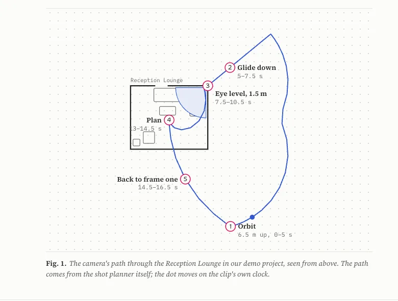
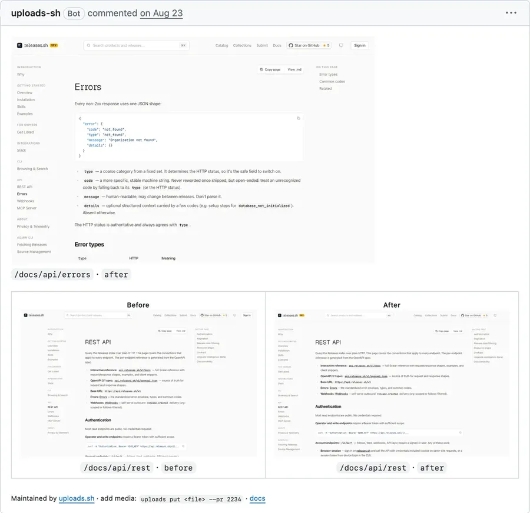
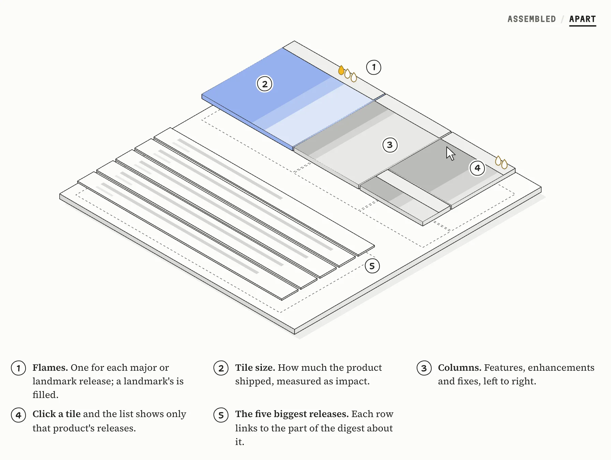
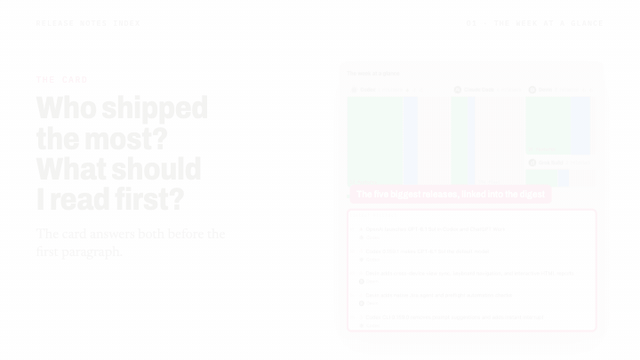
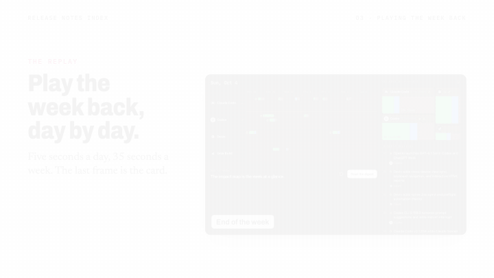
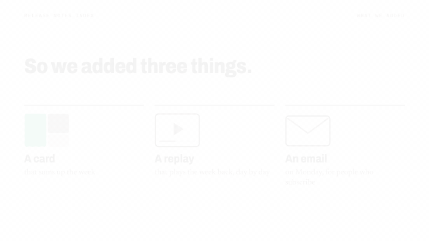
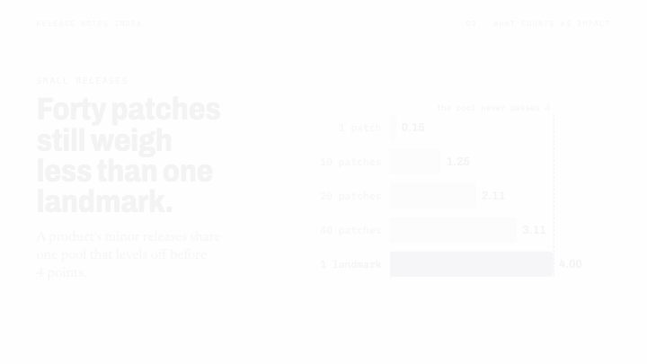

<h1 align="center">build-story</h1>

<p align="center"><b>A Claude Code skill that turns the history of a feature into a post about how it was built and why.</b><br>It reads the issues, PRs, commits, reviews and screenshots, finds the two or three decisions that shaped the feature,<br>and publishes a self-contained page with diagrams, motion, before/after visuals and real code.</p>

<p align="center">
  <a href="#quick-start">Quick start</a> ·
  <a href="#examples">Examples</a> ·
  <a href="#flavors">Flavors</a> ·
  <a href="#visual-components">Visual components</a> ·
  <a href="#motion-cut">Motion cut</a> ·
  <a href="#how-it-works">How it works</a> ·
  <a href="#install">Install</a> ·
  <a href="#scripts">Scripts</a> ·
  <a href="#developing">Developing</a> ·
  <a href="#limits">Limits</a>
</p>

<p align="center">
  
</p>

<p align="center"><sub><code>examples/weekly-digests</code>: the masthead and opening of a build story written by the skill from a public repo's PRs.</sub></p>

> [!NOTE]
> Prototype. Expect the rules and scripts to change.

---

Point Claude at an issue, a few PRs, a search phrase or a commit range, and ask it to write up how the feature was built. build-story gathers the record into a dossier, zooms out to the product as users meet it, picks an angle, and plans one chapter per idea, not per day. Then it draws the visuals from small specs, writes the page, and checks it: a linter for length, phrasing, process detail and safety, a link check, and a render pass at desktop and phone width in light and dark.

The skill exists to prevent three kinds of post:

- **The play-by-play.** The development process narrated in order, with timestamps, PR numbers and who reviewed what.
- **The changelog in prose.** Every change listed, no argument.
- **The press release.** Confident claims with nothing behind them.

The cure is the same for all three: find the few ideas and decisions that made the feature what it is, explain each at the level the reader needs, and back each one with real evidence from the record.

## Quick start

```bash
npx skills add buildinternet/buildnotes -g -a claude-code
```

For OpenCode or Codex, swap the agent: `-a opencode` or `-a codex`. OpenCode takes the same `/build-story` command; in Codex, type `$build-story`.

Then, in Claude Code, inside the repo the feature lives in:

```text
/build-story write up how we built the weekly digests (#412)
```

You need `git`, an authenticated `gh`, Node 22 or later, and Chrome for the render pass and figure export. The scripts use only Node's built-in modules: there is nothing to `npm install`.

## Examples

Three full runs are kept as committed examples. Each folder holds the finished page (one self-contained file with every image embedded), the story plan the agent wrote before drafting, its notes, the specs behind the rendered figures, and a [motion cut](#motion-cut) with its video.

### Walkthrough videos

[`examples/walkthrough-videos/`](examples/walkthrough-videos) is a build story about walkthrough videos in [Sunny](https://app.sunnysdk.com), a furniture and space planner: one export turns a room, a floor or a project into a looping 1080p tour. The repo behind it is private, so the post quotes no code and links nothing internal; it is about the product as its users meet it. Open [`post.html`](examples/walkthrough-videos/post.html) for the post, in the field notes style, or watch its 52-second cut:

https://github.com/user-attachments/assets/630f699d-4134-47bc-bcb2-da6b5a755225

<p align="center"><sub>The walkthrough-videos cut, 52 seconds. Its third scene is Sunny's own room export. The file is <a href="examples/walkthrough-videos/motion.mp4"><code>examples/walkthrough-videos/motion.mp4</code></a>.</sub></p>

<table>
  <tr>
    <td width="50%"></td>
    <td width="50%"></td>
  </tr>
  <tr>
    <td><sub><b>A path computed by the product.</b> Chapter 1 draws the camera's route from poses the shot planner itself computed, with a dot that moves on the clip's own clock.</sub></td>
    <td><sub><b>One frame, its parts named.</b> Chapter 2 keys a real video frame: the plan in the corner, the camera on it, and the caption.</sub></td>
  </tr>
</table>

### Before and after

[`examples/before-after/`](examples/before-after) is a build story about before/after comparison on [uploads.sh](https://uploads.sh), from the public `buildinternet/uploads` repo: tag two screenshots before and after, and the pull request comment shows them in one row; open either one, and a divider slides across both. Its figures are the product in use, captured live: a real pull request comment and the file page in Compare. Open [`post.html`](examples/before-after/post.html) for the post, in the Plain style, or watch its 47-second cut:

The cut: [`examples/before-after/motion.mp4`](examples/before-after/motion.mp4).

<table>
  <tr>
    <td width="50%"></td>
    <td width="50%"></td>
  </tr>
  <tr>
    <td><sub><b>The real thing, captured.</b> Chapter 1 shows a live comment: a pair shares a row, and a shot with no before shows on its own.</sub></td>
    <td><sub><b>The same pair in Compare.</b> Chapter 3 shows how the two shots are lined up from the top-left corner, so what moved is what changed.</sub></td>
  </tr>
</table>

### Weekly digests

[`examples/weekly-digests/`](examples/weekly-digests) is a build story about the weekly collection digests on Release Notes Index, from the public `buildinternet/releases` repo. Open [`post.html`](examples/weekly-digests/post.html) for the post in the Plain style, or [`post-field-notes.html`](examples/weekly-digests/post-field-notes.html) for the same post in field notes. Its one-minute cut is [`motion.html`](examples/weekly-digests/motion.html), built from [`motion.json`](examples/weekly-digests/motion.json) and exported as [`motion.mp4`](examples/weekly-digests/motion.mp4); it plays in the [Motion cut](#motion-cut) section below. 

<table>
  <tr>
    <td width="50%"></td>
    <td width="50%"></td>
  </tr>
  <tr>
    <td><sub><b>A keyed screenshot.</b> Chapter 1 shows the shipped card with its parts numbered. Pointing at a number opens its note, and the screenshot expands to full size.</sub></td>
    <td><sub><b>A flow with motion.</b> Chapter 4 explains how each reader gets exactly one email a week. The diagram is drawn by <code>viz.mjs</code> from a short JSON spec.</sub></td>
  </tr>
  <tr>
    <td colspan="2"></td>
  </tr>
  <tr>
    <td colspan="2"><sub><b>Before and after in one figure.</b> Two frames of the week replay, mid-week and at the end.</sub></td>
  </tr>
  <tr>
    <td colspan="2"></td>
  </tr>
  <tr>
    <td colspan="2"><sub><b>The same card, field notes style.</b> One parts list, measured on the capture, drawn at an angle and taken apart. The <code>anatomy</code> component draws it flat, at an angle, or as keys over the capture.</sub></td>
  </tr>
</table>

The images on this page were made with the skill's own [`scripts/export.mjs`](scripts/export.mjs), which exports any figure as a PNG, GIF, video or standalone SVG.

## Flavors

Three flavors. The skill picks one from the request and the size of the change, and you can ask for another.

| | **Release story** | **Build story** (default) | **Technical deep dive** |
|---|---|---|---|
| Reader | Users and prospective users | Developers who know the product | Engineers who want the mechanism |
| Answers | What's new, why it matters, how to use it | What we built, how it works, what shaped it | How it works inside, the trade-offs, the edge cases |
| Visuals | Screenshots, before/after, one simple flow | Diagrams, motion, before/after | Diagrams, terminal runs, charts |
| Code | A usage example at most | Only where the code is the idea | Where it helps |
| Length | Up to 1,200 words | Up to 2,500 words | As long as it needs |

Word counts are ceilings, not targets. A small change gets a **note** of a paragraph or three. A typo fix or a dependency bump gets an honest "not worth a post", and if it is one piece of a bigger idea, the skill names that idea and asks whether to write about it instead.

## Visual components

`scripts/viz.mjs` draws every visual from a small spec: JSON for most kinds, Markdown tables for options and matrices, GLSL for shaders. The output is plain HTML, SVG and CSS that inherits the page's theme, works in light and dark, reflows at phone width, and respects reduced motion. Each spec can be edited by hand and re-rendered.

<table>
  <tr>
    <td colspan="2"></td>
  </tr>
  <tr>
    <td colspan="2"><sub><b>flow</b>: boxes and routes with branches, labels and marching dashes. On a phone it stacks into a vertical drawing.</sub></td>
  </tr>
  <tr>
    <td width="50%"></td>
    <td width="50%"></td>
  </tr>
  <tr>
    <td><sub><b>options</b>: the decision and the alternatives that lost, with a reason for each.</sub></td>
    <td><sub><b>matrix</b>: options against criteria. A mark can carry a short note.</sub></td>
  </tr>
  <tr>
    <td></td>
    <td></td>
  </tr>
  <tr>
    <td><sub><b>delta</b>: a before/after number, and what was measured.</sub></td>
    <td><sub><b>line</b>: one or two series with a marked event.</sub></td>
  </tr>
  <tr>
    <td></td>
    <td></td>
  </tr>
  <tr>
    <td><sub><b>strip</b>: rounds of a design, or a filmstrip of states.</sub></td>
    <td><sub><b>term</b> and <b>code</b>: real output and real code, captioned with the file name.</sub></td>
  </tr>
  <tr>
    <td colspan="2"></td>
  </tr>
  <tr>
    <td colspan="2"><sub><b>shader</b>: a WebGL fragment shader, for posts where the pixels are the subject, shown on the reader's own screen.</sub></td>
  </tr>
</table>

Also: **steps** (a numbered pipeline with a moving highlight) and **bars** (a bar chart with one row marked). Open [`assets/components.html`](assets/components.html) in a browser to see every component next to its spec. The example specs are in [`assets/specs/`](assets/specs).

## Motion cut

Some people won't read a 1,500-word post but will watch a minute of video. The motion cut is the post as a reel of five to nine scenes that plays itself: the title, the problem, one scene for each idea, and how to try it. The agent writes a short scene script (`motion.json`) from the finished post, so every word, number and screenshot comes from the post. [`motion.mjs`](scripts/motion.mjs) checks the script, times each scene by how long its words take to read, builds one self-contained page, and exports a 1920×1080 MP4, a GIF, a still, or one scene as a short clip.

https://github.com/user-attachments/assets/c18c6e27-d6c7-469a-90d7-c3f512474357

<p align="center"><sub>The weekly-digests cut, one minute. The file is <a href="examples/weekly-digests/motion.mp4"><code>examples/weekly-digests/motion.mp4</code></a>.</sub></p>

<table>
  <tr>
    <td width="50%"></td>
    <td width="50%"></td>
  </tr>
  <tr>
    <td><sub><b>morph</b>: the same tiles, sized one way and then the right way. The wrong answer turns into the right one in front of the viewer.</sub></td>
    <td><sub><b>flow</b>: dots travel the route; one is stopped at the step that guards it.</sub></td>
  </tr>
  <tr>
    <td></td>
    <td></td>
  </tr>
  <tr>
    <td><sub><b>shot</b>: a ring moves across a screenshot's parts, naming each.</sub></td>
    <td><sub><b>swap</b>: one frame of a screen wipes over another.</sub></td>
  </tr>
  <tr>
    <td colspan="2"></td>
  </tr>
  <tr>
    <td colspan="2"><sub><b>clip</b>: the feature's own footage, from a GIF or video in the pull request, played inside the frame. This one is from the walkthrough-videos cut.</sub></td>
  </tr>
</table>

Also: **title**, **statement** (the problem, line by line), **list**, **bars** and **end** (where to go and what to press). Each clip above is one scene of an example's cut, exported with `--scene`:

```bash
node scripts/motion.mjs examples/weekly-digests/motion.json --mp4                       # the whole cut → export/motion.mp4
node scripts/motion.mjs examples/weekly-digests/motion.json --gif --scene 5 --size 720  # one scene → export/motion-scene-5.gif
```

The script format, the scene kinds and when to make a cut are in [`references/motion.md`](references/motion.md).

## How it works

<p align="center">
  
</p>

[`SKILL.md`](SKILL.md) holds the workflow and the rules. In short:

1. **Scope.** Settle the subject, flavor, repo visibility, house style and any opt-in modules. What you point at is a breadcrumb, not a boundary: related work landing around the same time often belongs to the same idea.
2. **Gather.** [`gather.mjs`](scripts/gather.mjs) pulls issues, PRs, commits, review threads, linked issues, nearby work and prior work into `dossier.md` and `dossier.json`, in a work dir outside the repo.
3. **Frame.** Zoom out to the product as users meet it, draft two or three angles, recommend one, and write a brief. Ask the author as little as possible: usually nothing, at most two questions.
4. **Plan.** A thesis, one beat per chapter (each with a decision, the alternative and a takeaway), cuts, and at most three open questions.
5. **Visuals.** For each beat, decide whether a visual earns its place, then write its spec and render it.
6. **Write.** Fill in [`assets/template.html`](assets/template.html). Most posts use four or five of its components and delete the rest. The page comes in two styles: Plain, the default and the one to rebrand, and field notes, a serif page with figures on a dot grid and flows drawn by hand ([styles](references/visuals.md#styles)).
7. **Check.** [`lint.mjs`](scripts/lint.mjs) does the mechanical half; then detail, craft, fact, safety and render passes.
8. **Publish.** [`inline-assets.mjs`](scripts/inline-assets.mjs) embeds the images, and the page goes up as a private Artifact with the open questions alongside.
9. **Motion cut (optional).** For people who would rather watch than read, [`motion.mjs`](scripts/motion.mjs) turns a short scene script into a reel of the post that plays itself in under a minute, and exports it as an MP4.

Every rule in `SKILL.md` names the fault that taught it, for example a tidy code snippet that matched nothing in the repo, or a link built by guessing a slug. The detail lives in [`references/`](references):

| File | Covers |
|---|---|
| [`brief.md`](references/brief.md) | Angles, the brief, and how little to ask the author |
| [`evidence.md`](references/evidence.md) | What to read, what to skip, numbers worth having, sources that disagree |
| [`story.md`](references/story.md) | Shapes, beats, altitude, references, voice, length |
| [`visuals.md`](references/visuals.md) | Diagram, motion, screenshot and chart patterns; spec formats; the render check |
| [`motion.md`](references/motion.md) | The motion cut: when to make one, choosing scenes, the script, build and export |
| [`modules.md`](references/modules.md) | Opt-in appendix modules: build log, numbers, timeline, review notes, how-made, sources |
| [`craft.md`](references/craft.md) | Titles, naming the product, anti-patterns, the hand-off |

## Install

build-story is a standard [Agent Skill](https://agentskills.io): a folder with a `SKILL.md` at its root. This repository is that folder. Pick one way in:

| | Command | Installs to |
|---|---|---|
| **skills CLI**, for you (Claude Code) | `npx skills add buildinternet/buildnotes -g -a claude-code` | `~/.claude/skills/build-story` |
| **skills CLI**, for you (OpenCode) | `npx skills add buildinternet/buildnotes -g -a opencode` | `~/.config/opencode/skills/build-story` |
| **skills CLI**, for you (Codex) | `npx skills add buildinternet/buildnotes -g -a codex` | `~/.agents/skills/build-story` |
| **skills CLI**, for one project | `npx skills add buildinternet/buildnotes` | `.claude/skills/build-story` for Claude Code, `.agents/skills/build-story` for OpenCode and Codex |
| **git**, for you (Claude Code) | `git clone https://github.com/buildinternet/buildnotes.git ~/.claude/skills/build-story` | `~/.claude/skills/build-story` |
| **git**, for you (OpenCode) | `git clone https://github.com/buildinternet/buildnotes.git ~/.config/opencode/skills/build-story` | `~/.config/opencode/skills/build-story` |
| **git**, for you (Codex) | `git clone https://github.com/buildinternet/buildnotes.git ~/.agents/skills/build-story` | `~/.agents/skills/build-story` |
| **git**, for one project | `git clone https://github.com/buildinternet/buildnotes.git .claude/skills/build-story` | `.claude/skills/build-story` (Claude Code and OpenCode) or `.agents/skills/build-story` (OpenCode and Codex) |

The [`skills`](https://github.com/vercel-labs/skills) CLI finds the `SKILL.md` at the root of this repository and installs it as `build-story`. Without `-g` it installs into the current project and asks which agents to set up. `-g` installs it for your user, and `-a claude-code` sets up Claude Code only; use `-a opencode` or `-a codex` for those.

With git, update by running `git pull` in that folder. If you already keep a checkout elsewhere, link it in instead, so the skill stays in step with that checkout:

```bash
ln -s /path/to/buildnotes ~/.claude/skills/build-story
```

Claude Code picks up new skills in a running session. OpenCode lists it as `/build-story`; Codex lists it under `/skills` and runs it with `$build-story`. Restart either if it doesn't show.

<details>
<summary><b>Codex: if gathering or the render pass is blocked</b></summary>

<br>

Codex runs commands in a sandbox. Two steps can trip it: `gather.mjs` calls `gh` over the network, and the render pass starts headless Chrome, which writes a temporary profile and talks to it over a local port. Work dirs also live outside the repo, in `~/.build-stories`. In order of preference:

1. When Codex asks to run one of these outside the sandbox, approve it for that command. This needs the default `approval_policy = "on-request"`.
2. Or allow it in `~/.codex/config.toml`:

   ```toml
   approval_policy = "on-request"
   sandbox_mode = "workspace-write"

   [sandbox_workspace_write]
   network_access = true
   writable_roots = ["/Users/you/.build-stories", "/tmp"]   # absolute paths
   ```

   Newer Codex releases may name these settings differently; check the config reference for your version.
3. Or set `BUILD_STORY_DIR` to a folder Codex can already write to.

</details>

### Requirements

The skill is written for Claude Code and follows the open [Agent Skills](https://agentskills.io) format, so OpenCode and Codex load it too. On those hosts it leaves the finished page as a file in the work dir instead of publishing an Artifact.

| Needs | For |
|---|---|
| Node 22+ | Every script. No npm packages. |
| `git` and an authenticated `gh` | Gathering the evidence |
| Chrome or Chromium | The render pass, figure export and component screenshots. Set `CHROME_PATH` if it isn't found. |
| `ffmpeg` (optional) | GIF and video export |

### Configuration

- `BUILD_STORY_DIR`: where work dirs go (default `~/.build-stories/<repo>/`). They live outside any repo, so runs survive worktrees and never land in tracked files.
- `house-style.md`: put one beside a repo's work dirs to record the product's exact name, shorthand, and terms to use or avoid. The skill reads it first and adds to it when you settle a term.

## Usage

Ask in plain words. The skill triggers on any request to write up how a feature was built, even one that never says "blog".

```text
/build-story how we built preview links, from PRs 120, 131 and 140
/build-story a release story for the rate-limit work (search "rate limit", the CLI half is in acme/cli)
/build-story a technical deep dive on the sync engine since v1.2.0, with the build log module
```

You get back a link to a private Artifact page, plus at most three open questions and two notes, one line each. The plan, notes, dossier and `post.html` stay in the work dir. Ask for `--standalone` HTML for your own site, or for the chapters as Markdown or MDX.

## Scripts

Each script runs on its own and prints usage with `--help` or no arguments.

| Script | What it does |
|---|---|
| [`gather.mjs`](scripts/gather.mjs) | Evidence dossier from git and GitHub: by `--issue`, `--pr`, `--search`, `--range`, `--since`, `--path` or `--grep`, with `--prior` and `--also-repo` |
| [`workdir.mjs`](scripts/workdir.mjs) | Makes a work dir under `$BUILD_STORY_DIR` and prints the house-style path when one exists |
| [`viz.mjs`](scripts/viz.mjs) | Renders every `<!-- viz … -->` marker in a page from its spec (`build <post.html>`) |
| [`lint.mjs`](scripts/lint.mjs) | Words per chapter, banned and writerly phrasing, process detail against the flavor's budget, numbers, sentence length, passive voice, identifiers, the product name in headings, a safety scan and a link check. Exits 1 on a hard failure. |
| [`render.mjs`](scripts/render.mjs) | Screenshots at 1280 and 390 px, light and dark. Fails on sideways scroll, clipped code and broken images. |
| [`export.mjs`](scripts/export.mjs) | One figure as PNG, GIF, MP4/WebM or standalone SVG, for slides or another blog (`--list` numbers them) |
| [`module.mjs`](scripts/module.mjs) | An opt-in appendix module (`build-log`, `numbers`, `timeline`) from the dossier |
| [`motion.mjs`](scripts/motion.mjs) | The motion cut: checks a scene script (`motion.json`), builds a reel page that plays itself, and exports it as a 1920×1080 MP4, WebM, GIF or still, or one scene as a clip (`--scene`) |
| [`inline-assets.mjs`](scripts/inline-assets.mjs) | Embeds local images and video as data URIs, so the page is one file |

```bash
node scripts/lint.mjs <work-dir>/post.html --flavor build --product "Release Notes Index,Releases" --avoid "codename"
node scripts/export.mjs <work-dir>/post.html --figure 4 --gif
```

## Developing

```bash
node --test dev/test/*.test.mjs                    # renderer, lint and export tests
node dev/shots.mjs                                 # every component at 1280 and 390 px, light and dark → runs/components/
node dev/gallery.mjs --publish                     # rebuild assets/components.html after changing a renderer or spec
node scripts/viz.mjs build assets/template.html    # re-render the template's examples
```

Like the render pass and figure export, `dev/shots.mjs` drives headless Chrome through [`scripts/chrome.mjs`](scripts/chrome.mjs), with no packages. It runs the four modes in parallel.

### Run history

`runs/` keeps a local, git-ignored history of test runs: each run's self-contained page, its plan, notes, author message, lint output and dossier, plus a `meta.json` with the skill commit and artifact link. Runs can hold private-repo content, which is why they stay out of git.

```bash
node dev/save-run.mjs <work-dir> --note "what this run tested" --artifact <url>
open runs/index.html
```

To keep a public run as a committed example, check it, then copy its page, plan and notes into `examples/<name>/` by hand.

## Limits

- **Built around GitHub.** Issues, PRs and review threads come through `gh`. Without them, the dossier is commit history only (`--range`, `--since`, `--grep`), and the story is thinner for it.
- **The record has to say it.** The skill infers angles and context, but not motives, quotes or numbers. When the record doesn't say why something was done, the reason stays out of the post and goes on the open questions.
- **Private repos link nothing internal.** The linter fails a `--private` post that links the repo's issues, PRs or commits.
- **No sign-ins for screenshots.** If a screen sits behind a sign-in the skill shouldn't use, it falls back to the PR's own images, a diagram or a terminal run.
- **Three examples so far.** `examples/` holds three runs: two from public repos, and one from a private repo that quotes no code.

## License

MIT. See [LICENSE](LICENSE), which also carries the notice for the capture script adapted from [anatomy](https://github.com/wheresryan22/anatomy).
